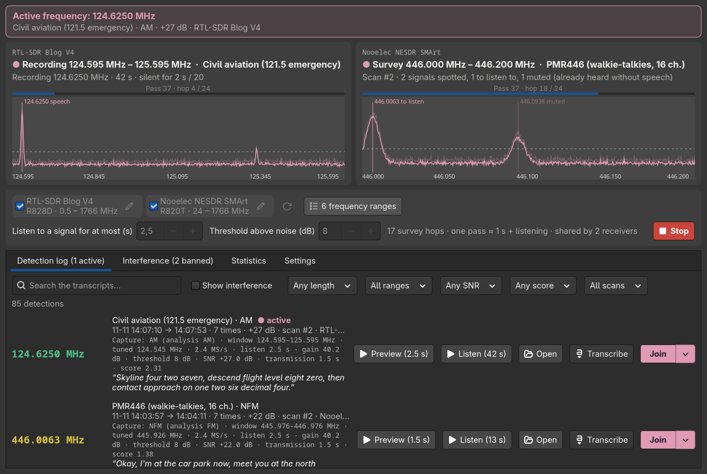

# ArchangeSDR

**A lightweight RTL-SDR scanner that finds people talking.** It sweeps the bands you choose, listens
only where something transmits, keeps what sounds like speech and records the whole conversation.
One Python file, packages from your distribution, nothing to compile: it runs on any Linux, from a
desktop PC to a ClockworkPi uConsole.



*During a scan: the Blog V4 records a conversation on 124.625 MHz, the second dongle surveys PMR446; the
log lists what was heard, with its transcript.*
More screenshots: [searching the transcripts](docs/screenshots/log-search.png) ·
[statistics](docs/screenshots/statistics.png) · [interference](docs/screenshots/interference.png) ·
[frequency ranges](docs/screenshots/ranges.png) · [settings](docs/screenshots/settings.png) ·
[notifications and transcription](docs/screenshots/settings-transcription.png) ·
[light theme](docs/screenshots/main-light.png)

## Why

A classic scanner stops on anything above its squelch: carriers, data bursts, interference. ArchangeSDR
checks the demodulated audio for speech (syllable rhythm, pauses, voice band, voice pitch), so the log
only fills with people talking, and it learns the frequencies that never speak. No AI is needed for
that, which keeps it fast on a small ARM board.

## Features

- **Fast sweep**: 0.1 s per 2 MHz hop, a listen only where a narrow signal shows up, the verdict as soon
  as it is clear (1 to 2.5 s).
- **Speech, not noise**: AM, FM and SSB are tried; carriers, data, tones and wide signals are rejected.
- **Whole conversations recorded**, pauses included, until 20 s of silence; a 2.5 s preview of each one.
- **Interference memory**: a frequency heard 3 times in a row without speech is banned for good; mark
  the false positives as "not interference".
- **Several receivers** share the work, each taking first what only it can tune (HF on a Blog V4), never
  two on the same frequency. RTL-SDR dongles out of the box; HackRF, Airspy, SDRplay, LimeSDR, PlutoSDR…
  through SoapySDR (optional).
- **Join**: open a frequency in GQRX, SDR++, rtl_fm or your own command.
- **Transcription** (optional), searchable: whisper.cpp on the machine itself, or any OpenAI-compatible
  API.
- **Push notifications** to your phone through [ntfy](https://ntfy.sh), for every recording or only
  some (score, frequencies).
- **Statistics**: which frequency is the busiest, the most interfered, which dongle hears what best.
- **Default ranges for 16 regions** (Europe, the Americas, Japan, China, Russia, Australia), in English,
  French, German and Spanish. Dark and light themes.

## Requirements

**Required**

| | Arch | Debian / Ubuntu / Raspberry Pi OS | Fedora | openSUSE |
|---|---|---|---|---|
| Python 3.8+ and numpy | `python-numpy` | `python3-numpy` | `python3-numpy` | `python3-numpy` |
| GTK 4 for Python | `python-gobject` `gtk4` | `python3-gi` `gir1.2-gtk-4.0` | `python3-gobject` `gtk4` | `python3-gobject` `typelib-1_0-Gtk-4_0` |
| librtlsdr | `rtl-sdr` | `rtl-sdr` | `rtl-sdr` | `rtl-sdr` |

Plus an RTL-SDR dongle (any model: Blog V3 / V4, Nooelec, generic R820T…). GTK 4 means Debian 12,
Ubuntu 22.04, Fedora 36, openSUSE Leap 15.4 or newer.

**Optional**, only for the feature next to it:

| For | What | Packages |
|---|---|---|
| Listening to the recordings | `pw-play` (PipeWire), else `paplay` or `aplay` | usually already there |
| Join a frequency | **one of** GQRX, SDR++, rtl_fm (with `aplay`), or your own command | `gqrx` (`gqrx-sdr` on Debian / Ubuntu); SDR++ from its [releases](https://github.com/AlexandreRouma/SDRPlusPlus/releases) or the AUR; rtl_fm comes with `rtl-sdr` |
| Transcription | whisper.cpp (`whisper-cli`), free and local, **or** an OpenAI-compatible API (a local server, OpenAI, Scaleway, Mistral, Groq…) | see [Transcription with whisper.cpp](#transcription-with-whispercpp) |
| Push notifications | the free [ntfy](https://ntfy.sh) app on your phone, subscribed to a topic (ntfy.sh or your own server) | nothing on the computer |
| Desktop notifications | `notify-send` and a notification daemon | `libnotify` (`libnotify-bin` on Debian / Ubuntu) |
| Receivers other than RTL-SDR (HackRF, Airspy, SDRplay, LimeSDR, PlutoSDR…) | SoapySDR's Python module and the receiver's SoapySDR module; the receiver must sample at 2.4 MS/s or more (the Airspy HF+ cannot) | Arch: `soapysdr` plus `soapyhackrf`, `soapyairspy`…; Debian / Ubuntu: `python3-soapysdr` plus `soapysdr-module-hackrf`, `soapysdr-module-airspy`… (or `soapysdr-module-all`); elsewhere the SoapySDR Python bindings and the module of the receiver |

## Install

```bash
git clone https://github.com/bt0r/ArchangeSDR.git
cd ArchangeSDR
./install.sh
archangesdr
```

`install.sh` installs for your user only (`~/.local/share/archangesdr/app` and the `archangesdr`
command in `~/.local/bin`), and tells you what is missing with the command for your distribution.
`./install.sh --uninstall` removes it; your settings and recordings stay.

**Dongle not found or busy?** The kernel's DVB-T driver grabs it. The `rtl-sdr` packages usually
blacklist it; otherwise:

```bash
echo 'blacklist dvb_usb_rtl28xxu' | sudo tee /etc/modprobe.d/blacklist-rtl.conf && sudo modprobe -r dvb_usb_rtl28xxu
```

Then unplug and replug the dongle. "Permission denied" means the `rtl-sdr` udev rules are missing: add
your user to the group they use (`plugdev` on Debian).

## Transcription with whisper.cpp

Transcription is optional, but it is what makes the log searchable. The free, local engine is
`whisper-cli` from [whisper.cpp](https://github.com/ggml-org/whisper.cpp): nothing leaves your
computer.

| Distribution | Install |
|---|---|
| Arch, EndeavourOS, Manjaro | `sudo pacman -S whisper-cpp` |
| Fedora | `sudo dnf install whisper-cpp` |
| Debian testing / unstable, Ubuntu 26.04 or newer | `sudo apt install whisper.cpp-tools` |
| Debian 12 / 13, Raspberry Pi OS (uConsole), older Ubuntu, others | build it (below) |

Building takes a few minutes on a PC, longer on a Raspberry Pi CM4:

```bash
sudo apt install build-essential cmake git      # or your distribution's compiler, cmake and git
git clone https://github.com/ggml-org/whisper.cpp
cd whisper.cpp
cmake -B build && cmake --build build -j --config Release
install -m 755 build/bin/whisper-cli ~/.local/bin/
```

Then, in **Settings → Transcription**: pick *whisper-cli*, choose a model and click **Install**.
`base` (60 MB) suits a uConsole, `large-v3-turbo` (574 MB) a recent PC. ArchangeSDR finds
`whisper-cli` in your `PATH`; another location goes in the *Program* field.

## Usage

```bash
archangesdr                              # the window
archangesdr --cli 144-146 --passes 3     # the same detection in a terminal: every signal and why
archangesdr --cli 144-148 --device 0,1   # with two dongles (USB index or serial number)
archangesdr --bands                      # the configured ranges
```

In the window: tick your dongles and your ranges, then **Scan**. Everything else (language, region,
theme, Join program, notifications, transcription) is in the **Settings** tab. `SIGUSR1` pauses the scan
and frees the dongles, for a launcher that needs them: `pkill -USR1 -f /archangesdr`.

A few settings live in a plain `KEY=value` file (`~/.config/archangesdr/archangesdr.conf` for the
standalone profile): `SDR_DEVICE` (the dongle ticked at the first start), `SDR_GAIN` (dB, 40 by default;
each dongle's own gain is set in the window), `SDR_ASYNC=0` (blocking USB reads, for a librtlsdr that
cannot stream), `SCANNER_LANG`, `SCANNER_REGION`.

## Regions

Each region has its own default ranges: FM starts at 76 MHz in Japan, the 2 m band stops at 146 MHz
outside the Americas, walkie-talkies use PMR446 in Europe, FRS in the Americas, UHF CB in Australia.

| Region | | Notable |
|---|---|---|
| `eu`, `fr`, `uk`, `de`, `es` | Europe | PMR446, CEPT CB; UK CB on 27.6 - 28 MHz |
| `us`, `ca` | USA, Canada | FRS / GMRS, MURS (US), 1.25 m, NOAA / Weatheradio |
| `br` | Brazil | extended FM 76 - 88, 80-channel citizen band |
| `ar`, `cl`, `co`, `sa` | South America | 60 m in Argentina; FRS and LPD 433 in Chile |
| `jp` | Japan | FM 76 - 95, 2 m 144 - 146, low-power radio on 421 / 422 / 440 MHz |
| `cn` | China | public walkie-talkies on 409 MHz |
| `ru` | Russia | LPD433, PMR446, CB grid C |
| `au` | Australia | UHF CB 476 - 477, 27 MHz marine |

Only analog voice is listed: digital voice, data and the services that must not be listened to (police,
emergency services, mobile phones) are left out.

## Desktops

ArchangeSDR runs on its own, and fits in two setups by the same author, whose files it reuses:
[archSDR](https://github.com/bt0r/archSDR) (Hyprland) and [uBonsole](https://github.com/bt0r/uBonsole)
(i3 on the uConsole). The profile is detected, or forced with `--profile archsdr|ubonsole|standalone`.

| Profile | Settings | History and recordings |
|---|---|---|
| `standalone` | `~/.config/archangesdr/` | `~/.local/share/archangesdr/` |
| `archsdr` | `~/.config/radio-menu/` | `~/.local/share/radio-menu/` |
| `ubonsole` | `~/.config/i3/` | `~/.local/share/ubonsole/` |

Under archSDR, the language and region are the menu's: `RADIO_LANG` and `RADIO_REGION` in
`~/.config/radio-menu/radio.conf`, else the system locale (the Settings tab still overrides them).

The project was called SDRScanner: `sdrscanner` stays a command for it, and an old standalone history
moves to the new folders at the first start.

## Privacy and the law

Your recordings stay on your computer, unless you choose a remote transcription API or ntfy
attachments. Listening to the radio is legal or tolerated in most countries; disclosing or using what
you hear often is not, and decrypting is never done. Check your local law: the last group of ranges of
each region says how it treats listening.

## Contributing

[AGENT.md](AGENT.md) explains the design decisions, the conventions and how to test without a dongle;
`tools/` holds the region generator, the screenshot script and a benchmark (`tools/bench.py`: the
processing cost of each scan step on your machine). Strings live in `lang/<lang>.sh` (English, French,
German, Spanish). The tests need nothing more than the program itself (synthetic signals, fake
receivers):

```bash
python3 -m unittest            # about 40 s
```

## License

MIT, see [LICENSE](LICENSE).
